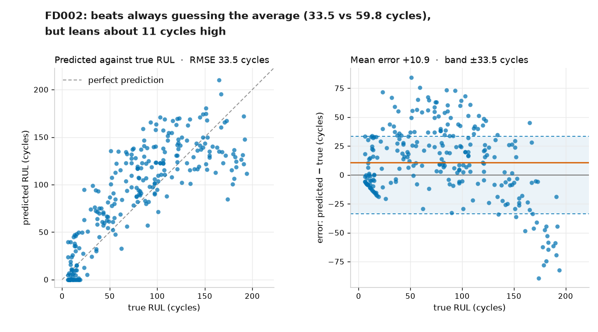

# RULPTE — Remaining Useful Life Prediction for Turbofan Engines

A readable study of how turbofan engines degrade, using NASA's C-MAPSS data: it
labels every recorded cycle with its remaining useful life (RUL) and fits a
deliberately simple baseline that predicts how many cycles an engine has left. It
runs on all four subsets, including the two with six flight conditions.

> **Test RMSE 33.5 cycles on FD002**, against 59.8 for always guessing the fleet
> average. FD002 is the hard one: 260 training engines, six operating conditions,
> 259 test engines. FD001, the textbook single-condition set, scores 28.3
> against 51.8.

The model is plain least squares on the 14 live sensors expanded to 42 features
(current value, trailing 20-cycle mean, 20-cycle change), with every sensor
standardised inside its own flight condition. Every feature looks backwards, so
the same numbers can be computed on an engine that is running right now. No deep
learning, so these are a floor, not a ceiling.

New to the vocabulary? **[GUIDE.md](GUIDE.md)** explains every term, every file
and every figure in plain words, with no maths.



*Figure 3 — FD002's 259 official test engines: predictions against the truth,
then the error against true life, with the ±RMSE band and the model's optimism.*

## Quick start (one command)

You need **Python 3.12 or newer** and **Git**. Nothing else — no libraries, no
data, no editor.

```powershell
git clone https://github.com/rafaa-sf/RULPTE.git
cd RULPTE
python run.py
```

`run.py` creates its own virtual environment, installs what the notebook needs,
downloads the NASA data the first time, and opens the notebook in your browser.
It is safe to run again: every step it has already done is skipped. If the
browser does not open by itself, copy the `http://127.0.0.1:.../?token=...`
address it prints into the browser.

No Git? Click **Code → Download ZIP** on the GitHub page, unpack it, open a
terminal in that folder, and run the same `python run.py`.

Then menu **Kernel → Restart Kernel and Run All Cells**. The three figures
appear under their cells. `Ctrl+C` twice in the terminal stops the server.

Want the scores without opening anything?

```powershell
python run.py --check
```

That runs the notebook headless and prints the two RMSEs, failing loudly if they
ever change. `python run.py --dry-run` shows the commands without running them.

The same workflow on a clean machine runs on every push in
[.github/workflows/from-zero.yml](.github/workflows/from-zero.yml), so "works
from zero" is checked, not claimed.

## Quick start (step by step)

Prefer to see every move? The same thing by hand, one step per section below.

```powershell
git clone https://github.com/rafaa-sf/RULPTE.git
cd RULPTE
python -m venv .venv
.venv\Scripts\activate
pip install -r requirements.txt notebook
python download_data.py
python -m notebook
```

Your browser opens a file list. Click **rul_prediction.ipynb**, then menu
**Kernel → Restart Kernel and Run All Cells**. The three figures appear under
their cells. `Ctrl+C` twice in the terminal stops the server.

The sections below explain each step of that block, for Windows, macOS and
Linux.

## What you get

- One command, `python run.py`, from a bare clone to the notebook running in
  your browser: environment, libraries and data all handled.
- A notebook that loads the data, checks it, plots it and scores a baseline
  model, top to bottom in a few seconds.
- Three figures: four engines followed from first flight to failure, the
  fleet-wide trend as RUL counts down, and the test-engine errors shown at the
  top of this page.
- No deep learning, no web app, no dashboard, and no editor required beyond a
  browser. Just the data and what it says.

## Results

All figures are RMSE in cycles. Lower is better.

| What is scored | FD001 | always guessing | FD002 | always guessing |
| --- | --- | --- | --- | --- |
| 20% of engines held out, every cycle | 44.8 | 71.0 | 41.0 | 69.8 |
| Same held-out engines, only cycles in the test's life range | 27.6 | 54.1 | 32.6 | 56.5 |
| Official test: one prediction per engine at its last recorded cycle | 28.3 | 51.8 | 33.5 | 59.8 |

Only the last row is the official score. The rows above are the honest checks
around it: the first includes young engines with 300 cycles left, the second is
scored the way the test set is scored.

The features were chosen on held-out engines cut at a random cycle, which is the
condition the test set poses, and never on the test score itself: 38.6 against
39.6 cycles on FD001, 39.4 against 39.9 on FD002. That gain is about one cycle,
inside the spread below, and the README says so rather than selling it.

Each prediction also carries a nominal 80% interval, sized on held-out engines
cut at an arbitrary cycle: **±45.9 cycles** on FD001 and **±49.8** on FD002. It
covers 85% of the official answers on FD001 and 84% on FD002: wider than
promised, which is the honest direction, because the model's mistakes are not
symmetric. The width rests on 20 engines and 25 draws, so it is coarse by a few
cycles.

How much of that is luck? Repeating the held-out split five times with a fresh
random cut each time gives **41.5 ± 2.2 cycles** on FD001 and **41.0 ± 2.4** on
FD002. The official test row is better than these, because the test engines are
scored once at their last cycle rather than across their whole lives — which is
why the like-for-like row exists above. The regime line says where the error
lives: on FD001, 28.1 cycles close to failure and 57.3 with more than 150 to go.

### Where this sits against published models

This model is deliberately a floor: least squares on 42 hand-built features, no
sequence model, no recurrent network. Sequence models trained on whole windows
report much lower errors on the same data — an attention-LSTM published by
[Dida et al., IJPHM 2025](https://doi.org/10.36001/ijphm.2025.v16i2.4274)
reaches RMSE 12.33 on FD001 and 11.76 on FD003, against this project's 28.3 on
FD001 (its Table 3, where the next best entries sit at 12.40 and 12.56). That gap
is the price of keeping the model readable in ten lines of numpy; it is not a
claim of parity. Published numbers also differ in RUL capping and clipping, so
compare magnitudes, not decimals.

### Use it on an engine you have not seen

The notebook is the report; `predict.py` is the tool. It trains the same model,
saves it, and answers for any file in the C-MAPSS format. With the virtual
environment activated:

```powershell
python predict.py train
python predict.py predict --subset FD002 --file data/test_FD002.txt
python predict.py score --subset FD001
```

`predict` prints one line per engine — `engine 4  RUL 88  p10 38  p90 138  PLAN`
— and the action comes from the pessimistic end of the interval, never the
middle:

| Lower bound on life | Action | What it means |
| --- | --- | --- |
| 5 cycles or fewer | `GROUND` | out of service until inspected |
| 6 to 20 | `INSPECT` | look before the next flight |
| 21 to 60 | `PLAN` | book the maintenance window |
| above 60 | `MONITOR` | no action yet |

**These four bands are an illustration, not a maintenance recommendation.** The
model's error on this simulated data is roughly 28 to 38 flights, so a lower
bound of 5 flights is not a five-flight guarantee — an engine can sit in
`MONITOR` and still fail first. Nothing here is airworthiness guidance: a real
fleet needs its own maintenance-interval, dispatch-reliability and inspection
rules, and a model proven on that fleet's own data.

`model.npz` is a build artefact (about 9 kB, not committed) and
`python predict.py train` recreates it.

`python run.py --test` trains the model and runs the test suite: five checks that the tool
reproduces the notebook's 28.3 and 33.5 and that the four bands map to the four
actions. Continuous integration runs both that and `--check` on every push.

## What you need

- Python 3.12 or newer (developed on 3.14; the pinned numpy 2.5.4 needs 3.12)
- Git, to clone the repository
- A notebook viewer: **Jupyter Notebook**, installed in step 3. No VS Code, no
  PyCharm, no account.
- About 43 MB of disk for the four subsets once unpacked (265,963 rows; the
  download itself is a ~12 MB archive that is deleted afterwards), and it is
  not committed

## 1. Get the code

```bash
git clone https://github.com/rafaa-sf/RULPTE.git
cd RULPTE
```

## 2. Create a virtual environment

Windows (PowerShell or cmd):

```powershell
python -m venv .venv
.venv\Scripts\activate
```

macOS / Linux:

```bash
python3 -m venv .venv
source .venv/bin/activate
```

Your prompt should now start with `(.venv)`. Every command below runs inside
that environment — including the notebook, which is why the figures and the
data libraries are guaranteed to be the same install.

If `python` is not recognised on Windows, use `py -3` instead of `python` in
both lines.

## 3. Install what the notebook needs

```powershell
pip install -r requirements.txt
pip install notebook
```

The first line installs the four libraries the notebook imports — pandas,
numpy, matplotlib and scikit-learn, the last for the k-means that finds the six
flight conditions — pinned to the versions it was verified with. The second
installs Jupyter Notebook, the browser-based viewer that runs the cells. It is
not pinned: any current version works.

## 4. Download the data

```bash
python download_data.py
```

It fetches the NASA archive once, keeps the twelve data files for all four
subsets, deletes the zip, and prints a sanity check per file. You should see:

```
  train_FD001.txt: 20631 rows, 100 engines -> OK
  ...
  train_FD002.txt: 53759 rows, 260 engines -> OK
  test_FD002.txt: 33991 rows, 259 engines -> OK
  RUL_FD002.txt: 259 rows -> OK
  ...
  RUL_FD004.txt: 248 rows -> OK
```

The files land in `data/`, which git ignores. Use `python download_data.py --force`
to download again.

If the download is blocked (locked-down network, proxy), the script prints
manual instructions: open the NASA Prognostics Data Repository, download the
*Turbofan Engine Degradation Simulation Data Set* zip, unzip it, and copy
the twelve files `train_`, `test_` and `RUL_` for `FD001` to `FD004` into
`data/`.

## 5. Open the notebook and run all cells

Start the viewer from the project folder, with the environment still active:

```powershell
python -m notebook
```

Your browser opens at `http://localhost:8888/tree`. If it does not open by
itself, copy the full URL the terminal printed — it ends in `?token=...` — and
paste it into the browser. Keep that terminal window open: closing it stops
the server.

Then:

1. Click **rul_prediction.ipynb** in the file list.
2. Check the kernel name at the top right: it must be the one from your
   environment (it normally reads *Python 3 (ipykernel)*). If the notebook
   cannot import pandas later, this is the first thing to check.
3. Menu **Kernel → Restart Kernel and Run All Cells**.
4. Cell by cell instead: click a cell and press **Shift+Enter**.

Two ways to stop: `Ctrl+C` twice in the terminal, or close the browser tab and
stop the process.

`python -m notebook` works even when the `jupyter` command is not on your PATH,
which is the usual reason `jupyter notebook` fails on Windows.

The notebook reads `data/`, so run step 4 first. Everything after that is
read-only: it creates no files.

## What to expect

- Train data: 20631 rows, 100 engines, 26 columns — unit, cycle, three
  operating settings, 21 sensor channels. Test data: 13096 rows, same columns
  for 100 engines. `RUL_FD001.txt` holds the 100 true end-of-life values.
- Seven of the 21 sensors never move (or move in only two values), so the
  notebook drops them and keeps 14.
- A **Sensor guide** table opens the notebook: all 21 sensors, what each one
  measures, its unit, and whether FD001 keeps it.
- Figure 1: four engines, 128 to 362 flights long, rising and falling sensors.
  Each panel is titled with the sensor's number, symbol and meaning, the vertical
  axis carries its unit, and the raw reading on every flight sits faintly under a
  bold 15-flight mean, so the trend clears the noise.
- Figure 2: the same sensors averaged over the fleet as the remaining flights
  count down, in 2×2 panels. The band is the middle half of the engines still
  flying. The plot stops at 240 flights left because fewer than 20 engines are
  still running beyond that, and the panel says so.
- The model: every cycle is one row, the 14 live sensors become 42 features
  (current value, 20-cycle mean, 20-cycle change), RUL is the target, and one
  engine in five is held back and never seen while fitting. Both subsets score
  in the results table above.
- Figure 3: FD002's test engines. The model leans about 11 flights high, and that
  lean is not flat — it is near zero for a dying engine, peaks near +30 with 40 to
  80 cycles left, and turns negative above about 140.
- Nothing is written to disk. The notebook only reads the data and draws.

## Reading it without the code

A notebook shows its code, but you do not have to look at it.

**Hide the code in place.** In JupyterLab open menu **View → Collapse All Code**
(command palette: *Collapse All Code*). Every code cell folds down to its
output, so what is left on screen is the written explanations, the printed
numbers and the three figures. The cells still run: **Run → Run All Cells** or
**Kernel → Restart Kernel and Run All Cells** executes everything and the
figures reappear below the folded cells. **View → Expand All Code** brings the
code back.

**Or export a read-only page.** After running all cells once, this writes
`rul_prediction.html` with the text and the figures and no code at all:

```powershell
pip install nbconvert
python -m nbconvert --to html --no-input rul_prediction.ipynb
```

Open the file with a double click. It needs no server, no kernel and no
libraries, so it is also the version to send to someone who just wants to read
it. It is a snapshot: re-export after any change, and keep it out of git.

### Prefer an editor?

VS Code: install the *Jupyter* extension, open `rul_prediction.ipynb`, pick the
interpreter inside `.venv`, and press *Run All*. The steps above are the same
without any editor.

## Project layout

```
run.py            one command: set up the environment, fetch data, open the notebook
predict.py        the model as a command: train, predict, score
tests/            pytest checks that predict.py matches the notebook
rul_prediction.ipynb      the notebook: load, check, label, plot, fit, score
download_data.py  fetches the NASA archive into data/
requirements.txt  pinned dependencies
GUIDE.md          plain-words explanation of every term, file and figure
LICENSE           MIT
figures/figure-3.png  the test-engine plot shown at the top of this page
.github/workflows/from-zero.yml  runs run.py --check on every push
data/             downloaded data (git ignored)
history.md        version history, newest first
```

## Troubleshooting

**`python run.py` says Python 3.12 or newer is required** — an older `python`
answered. Install 3.12+ from [python.org](https://www.python.org/downloads/),
then run `py -3.12 run.py` on Windows, or `python3.12 run.py` elsewhere.

**`python` is not recognised** — Python is not on `PATH`. On Windows try `py`
instead of `python`; the rest of the commands are unchanged.

**`No module named notebook`** — the viewer is not installed in the
environment you are running from. Run `pip install notebook` with the same
`python` you used to start it. To be certain, start it as
`python -m notebook` and check `python -c "import sys; print(sys.executable)"`.

**`jupyter` is not recognised, or `jupyter notebook` opens nothing** — use
`python -m notebook` instead. The `jupyter` shortcut is often missing on
Windows while the module is present.

**`ModuleNotFoundError: No module named 'pandas'`** — the notebook is running
on an interpreter that is not your virtual environment. In the notebook run
`import sys; print(sys.executable)`; the path must end in `.venv`. Pick that
kernel, or `pip install -r requirements.txt` in the active environment.

**The browser does not open** — copy the URL with the token from the terminal
into the browser by hand. If the port is taken, run
`python -m notebook --port 8889`.

**`python download_data.py` fails with a network error** — the NASA mirror was
unreachable. Retry, or use the manual download steps it prints.

**`Error: not found in the zip`** — a partial or wrong archive was downloaded.
Delete `data/` and run `python download_data.py --force`.

**The figures do not appear** — run the cells inside the notebook, not from a
plain `python` script, and do not add `matplotlib.use("Agg")`. Restart the
kernel and run all cells again.

**A matplotlib cache permission error** — point the cache somewhere writable
before starting the notebook:
`$env:MPLCONFIGDIR="$env:TEMP\mplcache"` (PowerShell) or
`export MPLCONFIGDIR=/tmp/mplcache` (macOS/Linux).

**`Permission denied` when writing `data/`** — the project is in a protected
folder. Move it somewhere under your home directory.

## Data credit

The data is NASA's C-MAPSS Turbofan Engine Degradation Simulation Data Set,
from the NASA Prognostics Center of Excellence at Ames Research Center.
Please cite it as:

> A. Saxena, K. Goebel (2008). *Turbofan Engine Degradation Simulation Data
> Set*, NASA Prognostics Data Repository, NASA Ames Research Center, Moffett
> Field, CA.

FD001 and FD003 have one operating condition; FD002 and FD004 have six, so
sensors are standardised inside each condition before anything is modelled.
The data is downloaded at run time and is not redistributed in this
repository.

## History

See [history.md](history.md) for what changed in each version.
